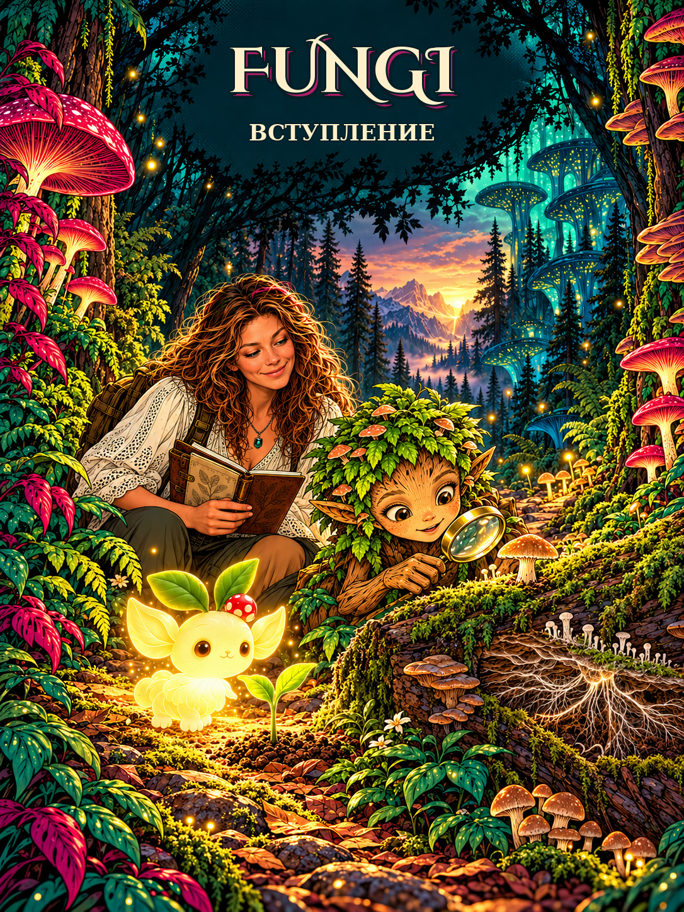

# Пролог · «Тропа в мир Fungi»

Люмик освещает лесную тропу и бережёт молодой росток. Героиня и любознательный дендроид входят в мир грибов.

Дендроид останавливается у старого бревна: «Сколько здесь незаметных следов! Может, лес хранит древний закон?»

Героиня открывает дневник: «Давай узнавать через наблюдение. Мы видим гриб, но большая часть его жизни может скрываться в древесине».

Впереди — 12 глав: от тонкой гифы до сложных связей всего леса. Сказочный свет Люмика помогает найти путь; научные ответы герои проверяют сами.
