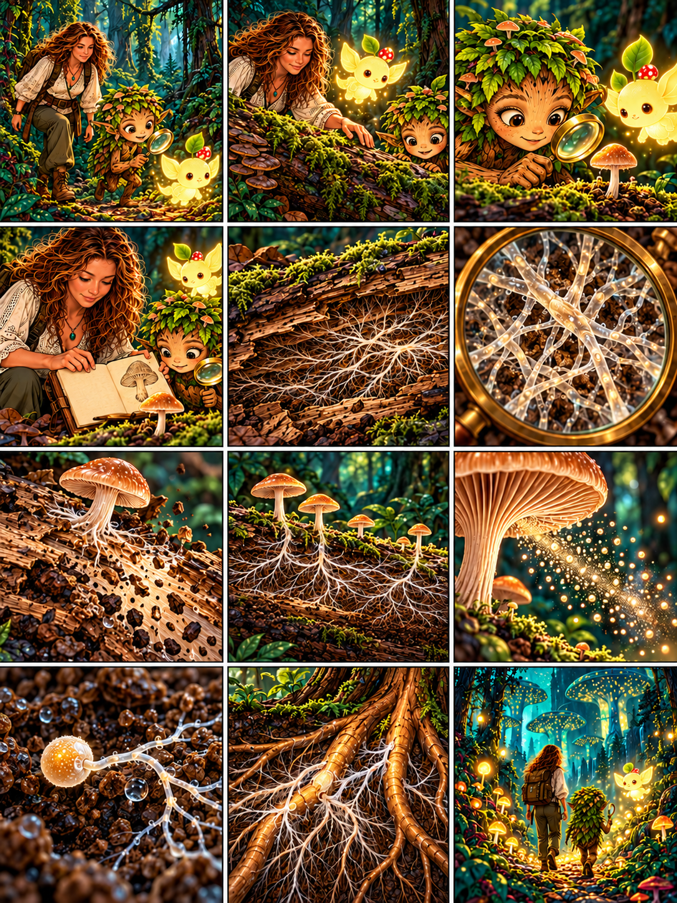

# Глава 01 · Невидимый лес

*Глава 01 «Невидимый лес» · текст к 12 кадрам*

*Преамбула · 1*
1. Героиня: «Мы уже узнали, как растут растения. Теперь посмотрим, кто помогает лесу разбирать упавшую древесину». Дендроид: «Люмик, веди нас в мир Fungi!»

*Экспозиция · 2–3*
2. Дендроид: «Здесь влажно и пахнет мхом. Старое бревно словно стало частью лесной почвы».
3. Дендроид: «Нашёл гриб! Похож на маленькое дерево». Героиня: «Похож только внешне: грибы — отдельное царство».

*Завязка · 4*
4. Героиня открывает дневник: «Мы видим шляпку и ножку. А где остальная часть этого гриба?»

*Развитие · 5–8*
5. Героиня: «Внутри древесины растут очень тонкие грибные нити — гифы».
6. Дендроид заглядывает в лупу: «Много ветвящихся гиф образуют мицелий — грибницу. Это не корни!»
7. Героиня: «Этот гриб разлагает мёртвую древесину и поглощает растворённые питательные вещества. Свет не служит ему источником энергии, как зелёному растению».
8. Дендроид: «Новые шляпки появились дальше по бревну!» Героиня: «У некоторых грибов плодовые тела вырастают из одной разросшейся грибницы».

*Кульминация · 9–10*
9. Из-под шляпки высыпаются споры. Дендроид: «Крошечные путешественники!»
10. Героиня: «Если спора попадёт в подходящие условия, она может прорасти и дать начало новым гифам».

*Развязка · 11*
11. Дендроид: «А возле моих корней тоже есть грибные нити?» Героиня: «Да, но это может быть уже *другой гриб*. Некоторые грибы образуют союз с корнями: помогают получать воду и минеральные вещества, а взамен получают сахара растения».

*Эпилог · 12*
12. Люмик освещает тихую тропу. Дендроид: «Мы заметили один гриб — а открыли целый невидимый лес!» Героиня: «И это только начало».

*Любопытный факт:* отдельная гифа обычно слишком тонкая для невооружённого глаза; белые «ниточки» на древесине часто состоят из множества гиф.
*Наблюдение:* незнакомые грибы не пробуем и не определяем съедобность по картинке.
