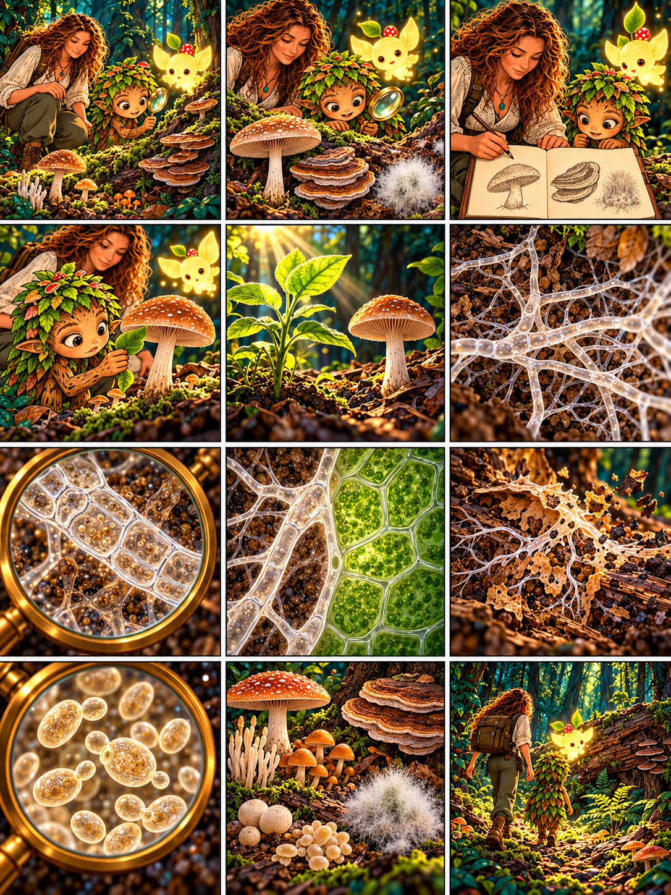

# Глава 02 · Кто такие грибы?

*Глава 02 «Кто такие грибы?» · текст к 12 кадрам*

*Преамбула · 1*
1. Люмик освещает лесную тропу. Дендроид: «Вчера мы нашли грибницу. Но кто вообще такие грибы?»

*Экспозиция · 2–3*
2. Героиня: «Посмотри: шляпочный гриб, трутовик на стволе и пушистая плесень. Все они могут быть грибами, хотя выглядят по-разному».
3. В дневнике появляются рисунки находок. Дендроид: «Значит, гриб — не обязательно шляпка с ножкой!»

*Завязка · 4*
4. Дендроид: «Я похож на растение, а гриб похож на маленькое дерево. Может, мы родственники?» Героиня: «Проверим, как мы устроены и питаемся».

*Развитие · 5–8*
5. Героиня: «Зелёные растения используют свет для фотосинтеза. Грибы так не делают: они получают готовые органические вещества из среды или от других организмов».
6. Дендроид: «Под грибом снова видны ветвящиеся гифы — тонкие нити, из которых часто состоит его тело».
7. Героиня: «Грибы состоят из клеток с оболочкой — клеточной стенкой. В её составе обычно есть хитин».
8. Дендроид: «У зелёного растения клетки с хлоропластами, а у гриба их нет. Значит, сходство с деревом только внешнее».

*Кульминация · 9–10*
9. Героиня: «Грибы выделяют вещества, расщепляющие пищу снаружи, а затем поглощают растворённые продукты».
10. Под лупой видны почкующиеся дрожжи. Дендроид: «Даже эти крошечные клетки — грибы? Их почти не видно без увеличения!»

*Развязка · 11*
11. Героиня: «Грибы — отдельное царство. Среди них есть одноклеточные дрожжи и многоклеточные виды: плесени, трутовики, привычные нам шляпочные грибы».

*Эпилог · 12*
12. Люмик ведёт друзей к старому бревну. Дендроид: «Теперь я знаю, кто они. А как именно гриб добывает пищу?» Героиня: «Это наше следующее исследование».

*Любопытный факт:* близкое родство грибов с животными не делает их животными: грибы выделены в самостоятельное царство. Следующая глава — 03 «Что ест гриб?»
