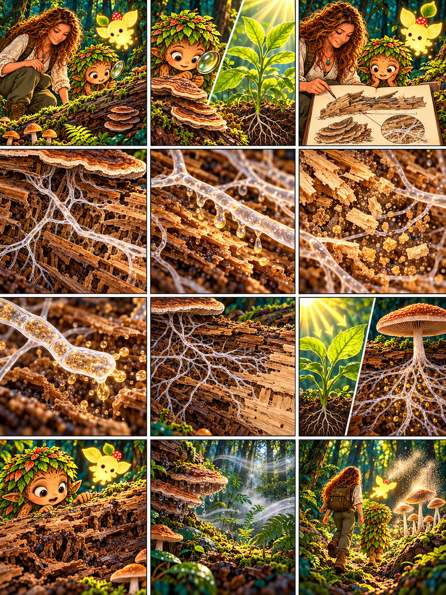

# Глава 03 · Что ест гриб?

*Глава 03 «Что ест гриб?» · текст к 12 кадрам*

*Преамбула · 1*
1. Дендроид: «Если гриб не питается светом, откуда он берёт вещества для роста?» Люмик освещает старое бревно.

*Экспозиция · 2–3*
2. Дендроид: «Растение тянется к солнцу, а этот гриб живёт на мёртвой древесине. Значит, питаются они по-разному?»
3. Героиня зарисовывает бревно: «Да. Проследим путь пищи у этого древесного гриба».

*Завязка · 4*
4. Под корой открываются тонкие нити. Героиня: «Гифы проникают в древесину, но крупные молекулы дерева не могут просто войти в грибную клетку».

*Развитие · 5–8*
5. Героиня: «Гифы выделяют наружу ферменты — вещества, которые помогают расщеплять древесину».
6. Дендроид: «Большие молекулы превращаются в более мелкие?» Героиня: «Да, часть продуктов растворяется во влаге».
7. Героиня: «Тогда гифы поглощают растворённые вещества через свою поверхность».
8. Дендроид: «Грибница разрастается внутри бревна и достигает новых участков пищи!»

*Кульминация · 9–10*
9. Героиня: «Зелёное растение с помощью света создаёт органические вещества. Этот гриб получает их из мёртвой древесины».
10. Дендроид касается рыхлой коры: «Похоже, гриб переваривает пищу снаружи, а уже потом поглощает её!»

*Развязка · 11*
11. Героиня: «Для роста нужны подходящие условия: влага, температура и доступ кислорода. У разных грибов потребности различаются».

*Эпилог · 12*
12. Люмик ведёт друзей дальше. Дендроид: «Теперь понятно, как питается этот гриб. А куда отправятся его споры?»

*Любопытный факт:* многие грибы начинают пищеварение вне своих клеток. Мы исследовали древесный гриб — не все грибы питаются древесиной.
