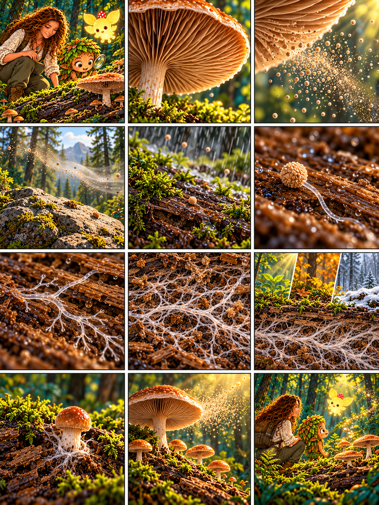

# Глава 04 · Путешествие споры

*Глава 04 «Путешествие споры» · диалоги к 12 кадрам*

*Преамбула · 1*
1. Дендроид: «Грибница живёт в бревне, а шляпка появилась над ним. Что произойдёт теперь?» Люмик подсвечивает гриб.

*Экспозиция · 2–3*
2. Героиня: «Посмотри под шляпку: у этого гриба там пластинки».
3. Из-под шляпки высыпаются крошечные споры. Дендроид: «Их так много!»

*Завязка · 4*
4. Ветер подхватывает споры. Дендроид: «Куда они попадут?» Героиня: «В разные места. На сухом камне этой споре не повезло».

*Развитие · 5–8*
5. После дождя другая спора оказывается на влажной древесине. Героиня: «Здесь условия могут подойти».
6. Под увеличением из споры появляется тонкая гифа. Дендроид: «Она прорастает!»
7. Гифа ветвится и растёт внутри древесины.
8. Героиня: «Разветвлённые гифы образуют мицелий — грибницу».

*Кульминация · 9–10*
9. Проходит время. Дендроид: «Грибница разрослась, но мы видим только её маленькую часть».
10. Над бревном появляется новое плодовое тело. Героиня: «У некоторых грибов при подходящих условиях грибница образует его».

*Развязка · 11*
11. Созревшая шляпка вновь выпускает споры. Дендроид: «История начинается снова!»

*Эпилог · 12*
12. Люмик ведёт друзей дальше. Героиня: «Одна спора не обещает нового гриба: большинству не подойдут условия, а у многих видов для плодового тела нужны ещё и совместимые партнёры».

*Любопытный факт:* спора — не семя. Она может дать начало гифам, но лишь часть спор успешно прорастает. Этот цикл показан на примере шляпочного гриба; у других грибов размножение бывает иным.
