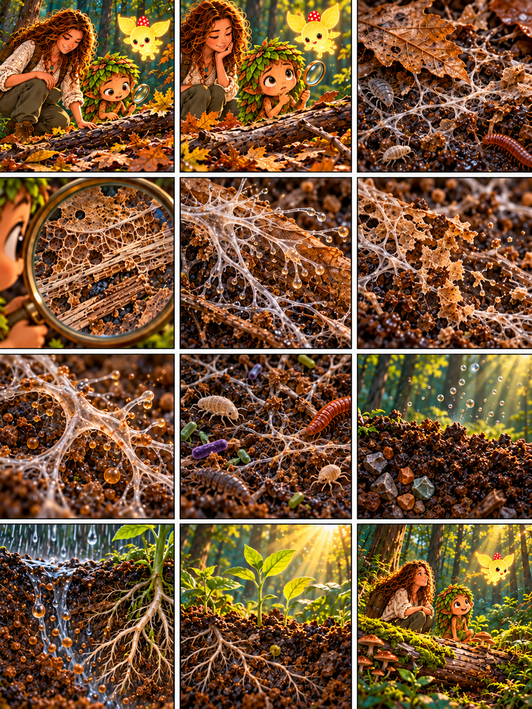

# Глава 05 · Возвращение в почву

*Глава 05 «Возвращение в почву» · диалоги к 12 кадрам*

*Преамбула · 1*
1. Героиня и Дендроид находят опавшие листья и старую ветку. Дендроид: «Каждый год листья падают. Почему лес не утонул в них?»

*Экспозиция · 2–3*
2. Героиня: «Посмотрим внимательнее. Листья не исчезают мгновенно — они постепенно разрушаются».
3. Под опадом Люмик освещает тонкие грибные нити и мелких почвенных животных. Дендроид: «Здесь работает целая команда!»

*Завязка · 4*
4. Через лупу видны нити на мёртвой древесине. Героиня: «Как грибам удаётся разбирать то, что осталось от растений?»

*Развитие · 5–8*
5. Героиня: «Гифы выделяют ферменты наружу. Они помогают расщеплять сложные вещества листьев и древесины».
6. Дендроид: «Материал постепенно распадается на более мелкие части».
7. Героиня: «Часть растворённых веществ гриб поглощает и использует для жизни».
8. Дендроид: «Но он не один: бактерии и почвенные беспозвоночные тоже участвуют в разложении».

*Кульминация · 9–10*
9. Героиня: «Часть веществ остаётся в почве, минеральные элементы снова становятся доступными живым организмам. Часть углерода возвращается в воздух как углекислый газ».
10. Дождь проходит сквозь почву. Дендроид: «Вода переносит растворённые вещества к корням растений!»

*Развязка · 11*
11. На солнечном участке растут молодые растения. Героиня: «Питательные элементы помогают им расти, а энергию для создания органических веществ они получают от света».

*Эпилог · 12*
12. Люмик освещает новую поросль возле старого бревна. Дендроид: «Мёртвое дерево не пропало бесследно — его вещества вернулись в круговорот леса».

*Любопытный факт:* разложение — общая работа грибов, бактерий и почвенных животных. Не вся древесина превращается в почву: часть её углерода уходит в атмосферу при дыхании организмов.
