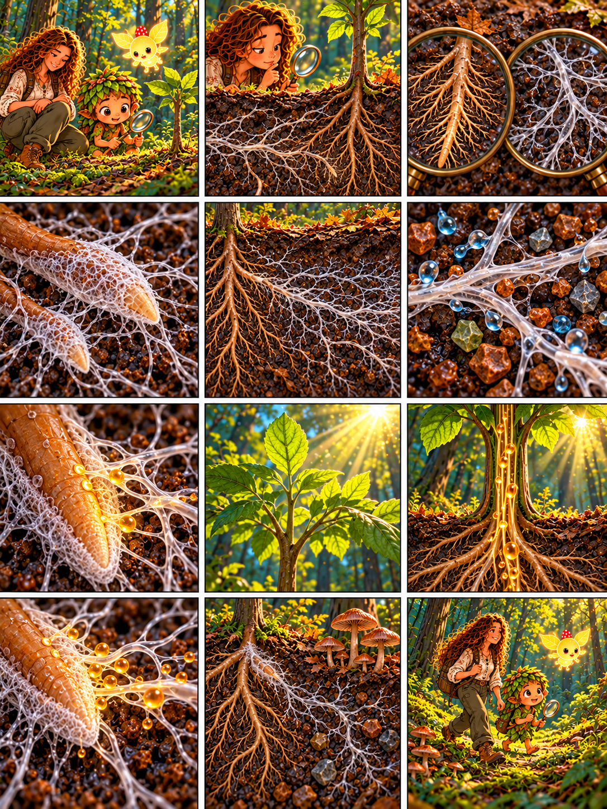

# Глава 06 · Союз с корнями

*Глава 06 «Союз с корнями» · диалоги к 12 кадрам*

*Преамбула · 1*
1. У молодого дерева Дендроид замечает тонкие нити в почве: «Люмик, подсвети! Что растёт возле его корней?»

*Экспозиция · 2–3*
2. Героиня: «Под землёй живут корни растения и гифы гриба. Они разные, даже если тесно соседствуют».
3. Дендроид смотрит в лупу: «Толстые разветвления — корни, тонкая сеть — грибница!»

*Завязка · 4*
4. Героиня: «У некоторых деревьев грибные нити окружают кончики корней. Такой союз называется микоризой».

*Развитие · 5–8*
5. Дендроид: «Грибница уходит в почву дальше корня. Что она там находит?»
6. Героиня: «Гифы поглощают воду и минеральные вещества, например фосфор».
7. «Часть полученного гриб передаёт растению через место контакта с корнем».
8. Над землёй листья ловят свет. Героиня: «А растение создаёт сахара при фотосинтезе».

*Кульминация · 9–10*
9. Дендроид: «Сахара из листьев движутся по растению к корням!»
10. Героиня: «У корня часть этих веществ получает гриб. Обмен идёт в обе стороны».

*Развязка · 11*
11. Дендроид: «Значит, гриб не просто живёт рядом: оба партнёра могут получать пользу». Героиня: «Да, но условия и выгода зависят от видов и среды».

*Эпилог · 12*
12. Люмик ведёт друзей по тропе. Дендроид: «Лес хранит союзы, которые с поверхности не увидеть!»

*Любопытный факт:* микориза — не «один общий мозг леса». Доказан обмен веществами между грибом и растением; истории о повсеместной передаче сообщений между деревьями пока нельзя считать установленным правилом.
