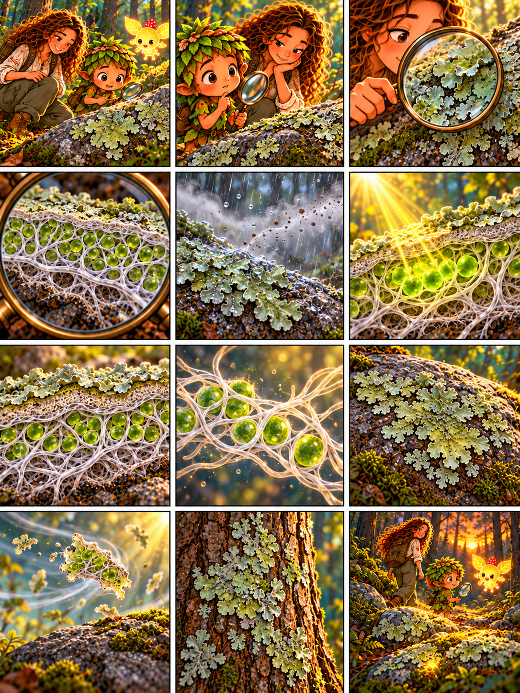

# Глава 07 · Лишайник: жизнь вместе

*Глава 07 «Лишайник: жизнь вместе» · текст к 12 кадрам*

*Преамбула · 1*
1. Дендроид замечает узоры на камне: «Люмик, смотри! Это маленькие листья?»

*Экспозиция · 2–3*
2. Героиня: «Это лишайник. Он не мох и не маленькое растение».
3. Дендроид рассматривает его в лупу: «Похож на кружевной островок, прикреплённый к камню».

*Завязка · 4*
4. Героиня: «Чтобы понять лишайник, заглянем внутрь: белые нити — гифы гриба, зелёные клетки — его партнёр, водоросль».

*Развитие · 5–8*
5. Дождь увлажняет камень. Героиня: «Лишайник получает влагу из окружающей среды».
6. Солнце освещает зелёные клетки. Дендроид: «Водоросль создаёт органические вещества с помощью света!»
7. Героиня: «Грибные нити образуют тело лишайника и помогают удерживать влагу, защищая зелёные клетки».
8. Дендроид: «Два разных организма живут так тесно, что мы видим один лишайник».

*Кульминация · 9–10*
9. Героиня: «Он растёт очень медленно даже на голом камне — год за годом».
10. Ветер переносит маленький кусочек лишайника. Дендроид: «В этом фрагменте путешествуют оба партнёра!»

*Развязка · 11*
11. Дендроид видит лишайник на коре: «Он питается деревом?» Героиня: «Этот лишайник лишь прикрепился к поверхности; сам по себе он не паразит дерева».

*Эпилог · 12*
12. Люмик освещает камни у тропы. Дендроид: «Даже тихий узор на камне оказался целым союзом!»

*Любопытный факт:* партнёром гриба в лишайнике бывает зелёная водоросль или цианобактерия. Лишайник — не отдельное царство, а тесное сожительство организмов.
