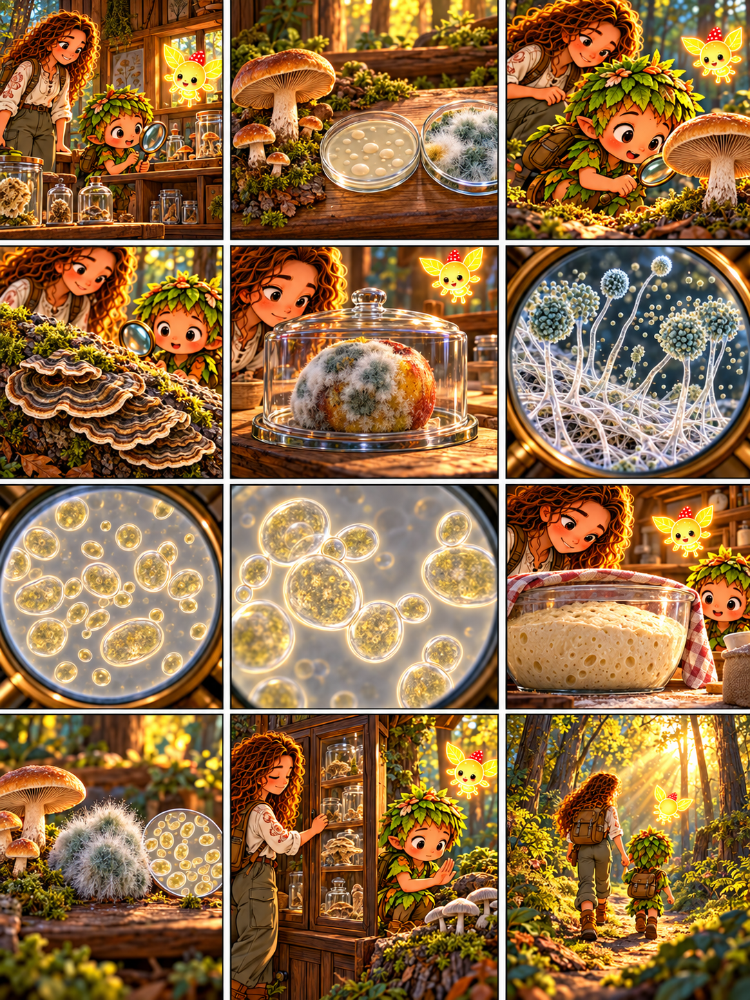

# Глава 08 · Грибы вокруг нас

*Глава 08 «Грибы вокруг нас» · диалоги к 12 кадрам*

*Преамбула · 1*
1. Друзья входят в лесной кабинет. Дендроид: «Здесь грибы совсем не похожи друг на друга!»

*Экспозиция · 2–3*
2. Героиня: «Посмотри на шляпочный гриб, дрожжи под увеличением и плесень в закрытой чашке».
3. Дендроид изучает шляпку: «Этот я узнаю по ножке и пластинкам!»

*Завязка · 4*
4. У бревна они находят трутовик. Дендроид: «А это тоже гриб, хоть у него нет привычной ножки?» Героиня: «Да».

*Развитие · 5–8*
5. Героиня: «Плесень на испорченном фрукте не трогаем и не нюхаем: рассматриваем только в закрытой ёмкости».
6. Под увеличением Дендроид видит гифы и структуры, образующие споры.
7. Под микроскопом — отдельные клетки дрожжей. Героиня: «Некоторые грибы одноклеточные».
8. Дендроид: «Одна дрожжевая клетка образует новую — она почкуется!»

*Кульминация · 9–10*
9. Тесто поднимается в миске. Героиня: «Дрожжи перерабатывают сахара и выделяют углекислый газ; его пузырьки разрыхляют тесто».
10. Дендроид: «Шляпочные грибы, плесени и дрожжи — такие разные, но все относятся к царству грибов!»

*Развязка · 11*
11. Героиня закрывает витрину: «В природе незнакомые грибы не пробуем, а заплесневелую пищу не едим».

*Эпилог · 12*
12. Люмик ведёт друзей обратно в лес. Дендроид: «Теперь я буду искать грибы не только среди шляпок!»

*Любопытный факт:* дрожжи — не отдельное царство, а образ жизни и форма некоторых грибов. Не всякая плесень и не каждый шляпочный гриб безопасны для человека.
