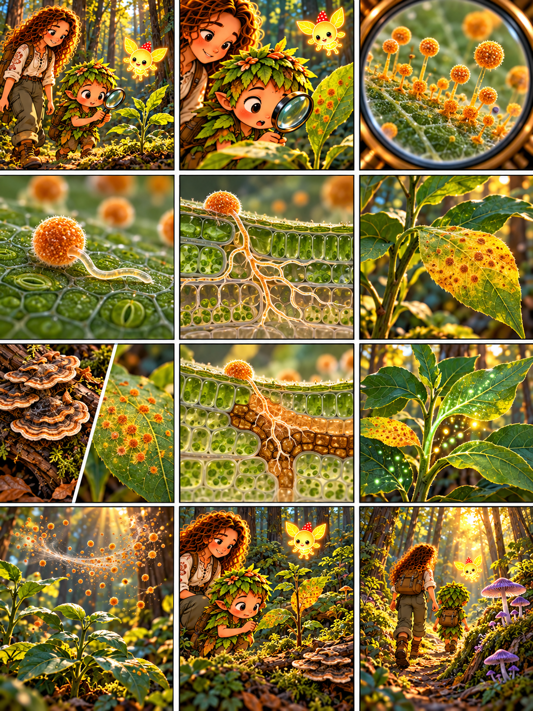

# Глава 09 · Лесные стратегии

*Глава 09 «Лесные стратегии» · диалоги к 12 кадрам*

*Преамбула · 1*
1. Друзья встречают молодой куст. Дендроид: «Как живут грибы рядом с живыми растениями?»

*Экспозиция · 2–3*
2. На одном листе Дендроид замечает рыжие пятнышки. Героиня: «Похоже на грибное поражение. Изучим, не трогая растение».
3. В лупу видны структуры гриба, образующие споры.

*Завязка · 4*
4. Героиня: «Попав на подходящего хозяина, спора некоторых паразитических грибов может прорасти».

*Развитие · 5–8*
5. «Гифы такого гриба получают вещества из живой ткани растения».
6. Дендроид: «Поражённый участок листа желтеет, но всё растение ещё живо».
7. Героиня: «На мёртвом бревне мы видели разлагателя. Здесь — другую стратегию: паразитизм».
8. «Растение не беззащитно: оно может ограничивать поражение защитными реакциями в тканях».

*Кульминация · 9–10*
9. Дендроид видит здоровые листья: «Болезнь не охватила весь куст!»
10. Героиня: «Споры рассеиваются, но заражение зависит от вида гриба, хозяина и условий среды».

*Развязка · 11*
11. Дендроид: «Значит, грибы не все полезны и не все вредны?» Героиня: «Именно. Их роли в лесу различны».

*Эпилог · 12*
12. Люмик ведёт друзей дальше. Дендроид: «Лес живёт не по одному правилу — в нём много стратегий».

*Любопытный факт:* даже у одного растения могут быть грибы-партнёры у корней и совсем другие грибы, вызывающие болезнь листьев. По рисунку нельзя надёжно определить конкретный вид или диагноз.
