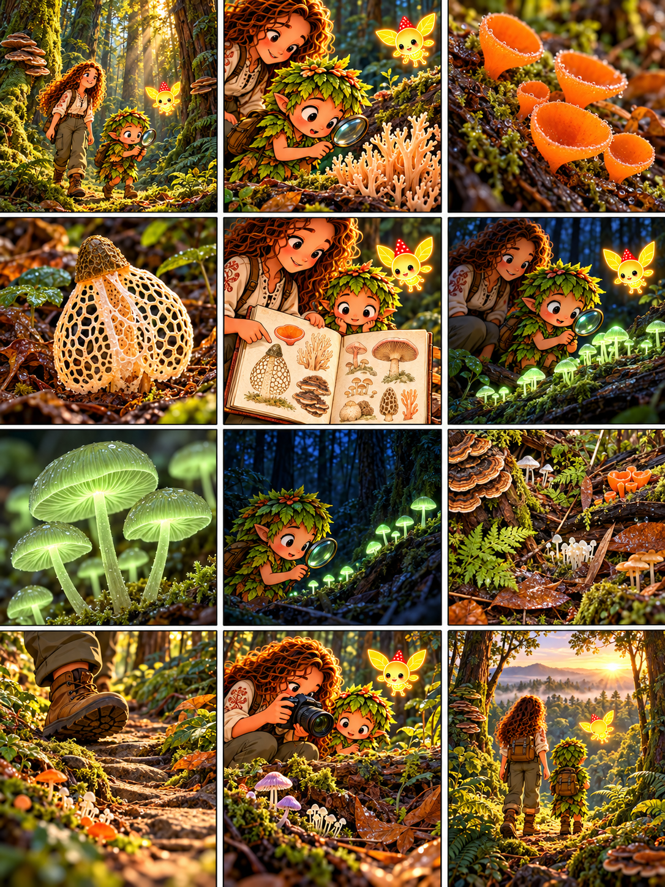

# Глава 10 · Редкие и удивительные

*Глава 10 «Редкие и удивительные» · диалоги к 12 кадрам*

*Преамбула · 1*
1. Люмик приводит друзей в старый влажный лес. Дендроид: «Какие грибы здесь прячутся?»

*Экспозиция · 2–3*
2. Дендроид находит ветвистый гриб: «Он похож на морской коралл!»
3. Героиня показывает яркие грибные чашечки: «Формы плодовых тел бывают очень разными».

*Завязка · 4*
4. Перед друзьями — решётчатый гриб. Дендроид: «Такое вообще бывает?» Героиня: «Да. Но необычная форма сама по себе не означает, что вид редкий».

*Развитие · 5–8*
5. Героиня зарисовывает находки, не срывая их.
6. В сумерках Дендроид замечает слабое зелёное свечение крошечных грибов.
7. Героиня: «У некоторых видов свечение возникает из-за химических реакций в их клетках».
8. Дендроид: «Днём я бы его не заметил!» Героиня: «И далеко не все грибы светятся».

*Кульминация · 9–10*
9. Героиня: «Старые брёвна, влажность и тень создают места жизни для разных грибов».
10. Дендроид остаётся на тропе: «Чтобы сохранить их дом, не будем топтать лесную подстилку и ломать древесину».

*Развязка · 11*
11. Героиня фотографирует гриб: «Редкие виды лучше изучать без сбора. Охрана места обитания важнее красивой находки».

*Эпилог · 12*
12. На рассвете Люмик ведёт друзей дальше. Дендроид: «Оказывается, удивительное можно увидеть, не забирая его из леса».

*Любопытный факт:* биолюминесценция известна у некоторых грибов; зачем она возникла у разных видов, учёные продолжают исследовать. Редкость и охранный статус зависят от конкретного вида и региона.
