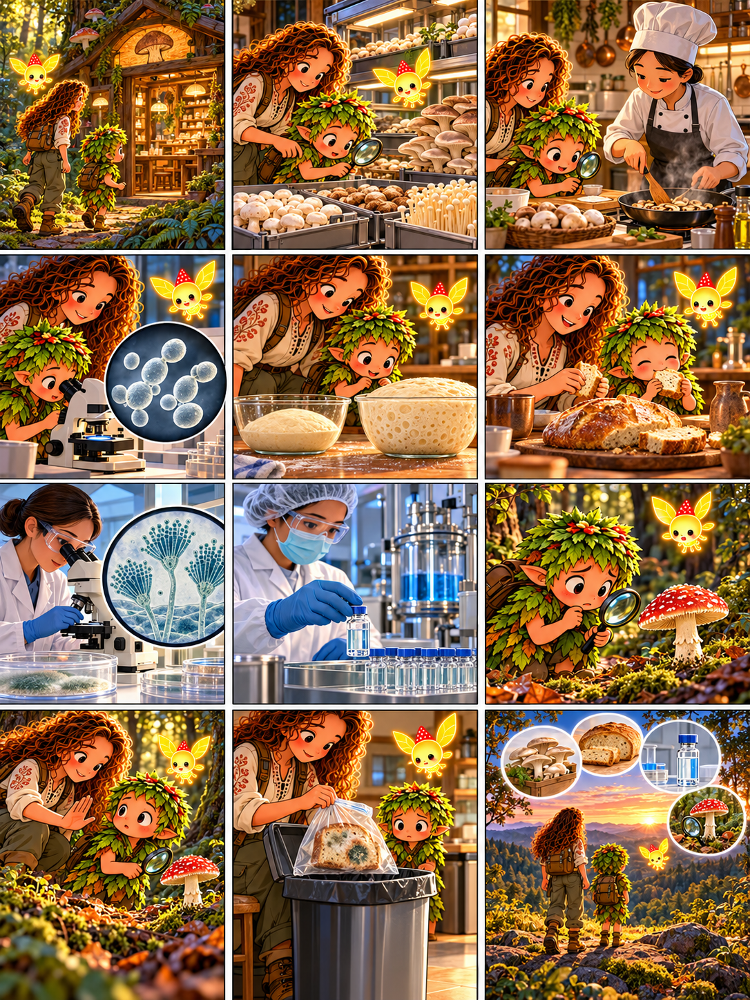

# Глава 11 · Грибы и человек

*Глава 11 «Грибы и человек» · диалоги к 12 кадрам*

*Преамбула · 1*
1. Друзья входят в лесную учебную кухню. Дендроид: «Где грибы встречаются с человеком?»

*Экспозиция · 2–3*
2. Героиня: «Эти грибы выращены специально для еды».
3. Повар готовит их. Дендроид: «Здесь мы знаем, что за вид в корзине».

*Завязка · 4*
4. Под микроскопом видны дрожжи. Дендроид: «А эти крошечные грибы тоже помогают людям?»

*Развитие · 5–8*
5. Героиня: «Дрожжи перерабатывают сахара и выделяют газ — поэтому тесто поднимается».
6. Друзья пробуют готовый хлеб.
7. В лаборатории исследуют плесневый гриб рода Penicillium.
8. Героиня: «С исследования таких грибов началась история пенициллина. Лекарства получают и проверяют в контролируемых условиях».

*Кульминация · 9–10*
9. В лесу Дендроид находит незнакомый гриб: «А этот можно съесть?»
10. Героиня останавливает его: «Нет. По виду на картинке съедобность не определяют; лесные грибы не пробуем».

*Развязка · 11*
11. Заплесневелый хлеб отправляют в отходы. Героиня: «И плесень на пище не превращает её в лекарство».

*Эпилог · 12*
12. Люмик ведёт друзей дальше. Дендроид: «Грибы дают пищу, помогают делать хлеб и лекарства — но обращаться с ними надо грамотно».

*Факт:* пенициллин не «любая плесень», а конкретные вещества, открытые благодаря научным исследованиям и производимые под строгим контролем.
