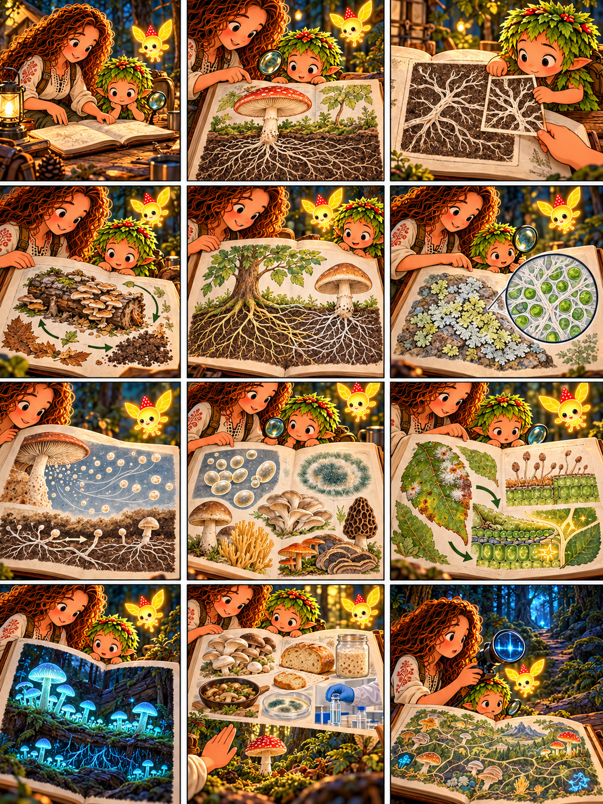

# Глава 12 · Карта царства Fungi

*Глава 12 «Карта царства Fungi» · диалоги к 12 кадрам*

*Преамбула · 1*
1. Героиня раскрывает дневник. «Мы прошли лесную тропу. Соберём открытия в одну карту?»

*Экспозиция · 2–3*
2. Дендроид: «У шляпочного гриба видимое плодовое тело, а в субстрате — гифы и мицелий».
3. Он кладёт рисунок тонких нитей рядом с рисунком гриба: «Гифы — не корни».

*Завязка · 4*
4. Люмик подсвечивает старое бревно на карте. Героиня: «Как все эти существа связаны с жизнью леса?»

*Развитие · 5–8*
5. «Разлагатели возвращают вещества из мёртвых остатков в круговорот».
6. «Некоторые грибы образуют микоризу с корнями растений; другие входят в состав лишайников вместе с водорослью или цианобактерией».
7. Дендроид: «Споры могут разлетаться, а в подходящих условиях — прорастать».
8. Героиня: «Есть дрожжи, плесени и грибы с самыми разными плодовыми телами».

*Кульминация · 9–10*
9. Дендроид: «Одни грибы помогают соседям, другие паразитируют. Лес не делится на просто “хороших” и “плохих”».
10. Люмик указывает на рисунки необычных грибов. Героиня: «Некоторые светятся; редкие виды и их места обитания нуждаются в охране».

*Развязка · 11*
11. Дендроид: «А люди выращивают пищевые грибы, используют дрожжи и создают лекарства — соблюдая безопасность».

*Эпилог · 12*
12. Карта готова. В приборе героини вспыхивает незнакомый синий сигнал. Дендроид: «Это ещё одно свойство грибов?» Героиня: «Пока не знаем. Не будем выдавать загадку за научный факт — проверим её в следующем путешествии». Люмик освещает новую тропу.

*Итог акта:* грибы — отдельное царство с множеством форм и ролей; фантастический сигнал остаётся вопросом, а не объяснением природы.
